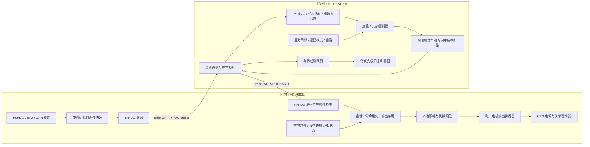
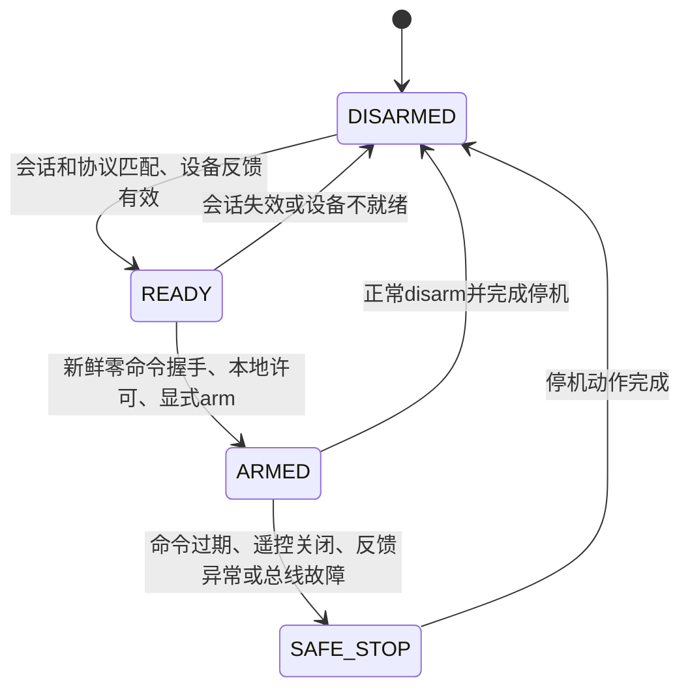

# 弱下位机与 EtherCAT 控制上移规划

日期：2026-11-18。范围：Sentinel 下位机与 Linux/SOEM 上位机之间的职责划分、通信契约、控制迁移和验收。

本文是实施规划。本次只新增文档，不修改控制代码、参数、固件配置或上位机，不编译、烧录或运行电机。文中的拟议目录、PDO 字段、周期和超时值尚未实施。

## 1. 结论和目标

采用“上位机计算控制量，下位机采集、校验并执行”的方案。

- 下位机采集遥控器、IMU、CAN 电机反馈和设备状态，通过 EtherCAT 上报。
- 上位机完成遥控业务映射、状态估计、底盘运动学、云台协同、目标轨迹、PID 和前馈计算。
- 上位机下发每个电机的执行量，下位机完成限幅、权限校验、协议编码和定时 CAN 输出。
- 下位机始终保留本地失联保护、机械限位、输出上限和急停否决权。上位机故障时无需等待上位机发停机包。

“上位机下发电流”对当前底盘成立，对全部电机不成立：

| 对象 | 上位机输出 | 下位机执行 | 留在电调内部的控制 |
| --- | --- | --- | --- |
| 四个 DJI C620 底盘电机 | 电流指令，A | 转成 DJI 协议原始值，组成 CAN1 `0x200` 帧 | 电调内部电流控制 |
| 大小 yaw、上下 pitch 的达妙电机 | 力矩指令，N·m | 使用现有 MIT 模式，位置/速度增益保持为零，发送力矩字段 | 驱动器内部控制 |

统一称为 `MotorEffortCommand`，但电流和力矩必须在协议中区分。不能把 A 直接写进 N·m 字段，也不能在未经型号和力矩常数核实的情况下把达妙统一改成电流控制。

建议最终保留“设备协议层”，而不是把 MCU 退化成任意 CAN 字节透传器。上位机表达“某槽位电机输出多少 A/N·m”，下位机决定允许不允许、如何编码、何时发送。原始 CAN 透传只作为受限诊断功能，不能绕过输出保护。

## 2. 当前代码和已经获得的证据

### 2.1 当前实现

| 功能 | 当前入口 | 迁移注意点 |
| --- | --- | --- |
| EtherCAT | [trd_ecat.cpp](../project/thread/ecat/trd_ecat.cpp)、[PDO 定义](../project/thread/ecat/trd_ecat.hpp) | 双向各 256 B，目前发送计数测试数据，还没有电机命令租约和执行状态机 |
| 底盘控制 | [trd_chassis.cpp](../project/thread/chassis/trd_chassis.cpp) | 运动学、坐标变换、PI、摩擦/惯量前馈、CAN 回调注册和电机初始化混在同一业务入口中 |
| yaw 控制 | [trd_yaw.cpp](../project/thread/gimbal/yaw/trd_yaw.cpp)、[协同分配](../project/thread/gimbal/yaw/trd_yaw_coop.cpp) | 遥控积分、协同分配、IMU 反馈环和电机输出需要一起明确迁移边界 |
| pitch 控制 | [trd_pitch.cpp](../project/thread/gimbal/pitch/trd_pitch.cpp) | 包含目标平滑、角环、重力补偿、限位和电机生命周期 |
| IMU | [trd_imu.cpp](../project/thread/imu/trd_imu.cpp) | `ImuManager` 内部包含采样、姿态解算和加热控温；不能只搬这个配置入口就视为迁完算法 |
| 遥控 | [trd_remote.cpp](../project/thread/remote/trd_remote.cpp)、[DR16 映射](../modules/remotes/remote_map_dr16.cpp) | 硬件协议解析和机器人模式映射要区分；本地关闭输出条件仍需直接可用 |
| CAN 输出 | [trd_can_tx.cpp](../project/thread/can/trd_can_tx.cpp) | 当前按队列取帧、每次发送可等待 1 ms；不能原样视为有确定截止时间的执行通道 |
| 共享偏角 | [gimbal.hpp](../project/thread/gimbal/gimbal.hpp)、[gimbal.cpp](../project/thread/gimbal/gimbal.cpp) | 控制上移后，偏角由上位机使用同帧反馈计算，不再依靠 MCU 全局变量作为控制数据接口 |

公共树 `E:/Zephyr/zephyr_user` 提供 IMU/Remote/Motor 模块、算法、HAL 和 EtherCAT 协议栈。下位机通过项目层装配这些模块，不为迁移重写已有协议栈。

当前 Kconfig 的若干控制/采集线程默认关闭，不能凭源码存在就认为它们已在当前固件运行。实施时以实际构建 `.config` 为准，建立明确的硬件采集与控制归属配置。

### 2.2 通信和硬件基线

- MCU：HPM5E31；EtherCAT 使用 Port0 RTL8201F，MDIO 地址 1。Port1 PHY 未焊接，保持关闭。
- SII：`DUST_ECAT_SII_FLASH_READONLY`，ESC 处于 EEPROM 仿真模式，数据来自固件 Flash 的只读镜像；支持读取/reload，不持久化主站写入。
- 现有 PDO：RxPDO、TxPDO 各 64 个 `uint32_t`，均为 256 B。
- 主站日志已出现持续 `WKC=3/3`、AL `0x08`、错误码 0；用户提供的一段日志最大发送间隔为 1.909 ms。这是该段链路运行证据，不是控制闭环或最坏时延保证。
- 曾保存过一次从站 `0x001B` 看门狗故障：100 ms 内未持续收到有效输出数据；原因未定位。主站故障检测的修改来自用户提供的说明，本次未读取主站修复源码，也不将其视为已独立审核。
- `ecat fault` 保存首次历史现场，不表示实时 AL 状态。每轮验收前记录/清除旧现场，区分主动停主站与意外掉线。
- CAN 静态内存优化另见 [CAN 内存问题记录](CAN内存占用待优化记录-2026-11-18.md)，本次迁移不顺带处理。

## 3. 最终职责分工

| 职责 | 下位机 | 上位机 |
| --- | --- | --- |
| UART/DMA、DR16/SBUS 帧解析、物理链路失联 | 保留 | 接收解码快照 |
| 遥控模式、底盘/云台目标、自瞄/行为决策 | 仅提取本地输出许可/急停否决 | 主责 |
| IMU 总线读取、物理时间戳、基本标定和温度读取 | 保留 | 接收采样 |
| IMU 加热控温 | 保留本地闭环和温度上限 | 配置/观测，不逐拍驱动加热 PWM |
| IMU EKF/姿态解算 | 迁移初期保留，最终可关闭 | 最终主责，先与下位机影子对比 |
| CAN 收发、中断回调、反馈解析和新鲜度 | 保留 | 使用设备快照 |
| 底盘坐标变换、运动学、速度 PI、前馈 | 移除正常业务计算 | 主责 |
| yaw 协同、世界角参考、pitch 目标平滑/角环/补偿 | 移除正常业务计算 | 主责 |
| 运动目标限速/轨迹平滑 | 不对正常指令额外增加未说明的平滑 | 在 PID 之前处理参考目标 |
| 协议量程校验、输出绝对上限、局部限位否决 | 独立保留 | 正常控制也进行约束 |
| 电机使能、失能、故障清除、设零的 CAN 编码和时序 | 本地非阻塞设备状态机 | 请求操作，等待应答，不直接拼硬件命令 |
| EtherCAT 失联、命令过期、主站重启后的停机 | 必须独立执行 | 同时检测和请求停止 |
| 参数调试、辨识、记录、可视化 | 硬件与保护参数、最小故障现场 | 控制参数、模型、轨迹、运行记录 |

“弱下位机”削减的是机器人正常控制与决策职责，不删除硬件服务和输出保护。尤其不能让 IMU 加热器因为上位机退出而停留在最后一个高占空比。

## 4. 控制和通信架构



### 4.1 单一输出所有者

每个电机同一时刻只能由一方计算正常执行量：`LOCAL` 或 `HOST`。配置/握手失败、复位和恢复时默认为禁止输出。

保留现有电机协议解析和 CAN 回调，但将它们从 `trd_chassis.cpp`、`trd_yaw.cpp`、`trd_pitch.cpp` 中拆到独立硬件装配层。否则关闭原控制线程时，会同时丢掉电机初始化、反馈接收或使能处理。

所有正常输出和停机输出最终经过同一个执行器。旧控制线程不能继续旁路调用 `PackCurrent()`、`SetTargetTorque()` 并向发送队列塞帧。移交时清空旧待发控制量，切换过程先停机，不做带负载热切换。

### 4.2 上位机线程与 SOEM 所有权

首版采用一个有界周期任务持有 SOEM context/IOmap，并驱动纯控制模块；日志、磁盘、UI、网络业务目标在其他线程运行。

- 周期任务从上一轮有效快照计算命令，编码后执行本轮 send/receive；收到反馈供下一轮使用，明确存在一拍管线延迟。
- 控制算法以 `Snapshot + Target + dt -> Effort` 形式运行，不持有 SOEM、串口、GUI 或日志线程。
- 同一 SOEM context 的周期收发、AL 状态访问、SDO 和恢复操作通过明确仲裁串行化。不能加一把长期互斥锁，让监测线程随时持锁执行阻塞恢复，再堵住实时收发。
- 初始化/恢复可在“未使能”的管理阶段执行。运行中的低频管理访问必须有时间预算，超出预算转入停机恢复阶段。
- 所有普通业务线程只提交目标快照，不直接修改 IOmap。

SOEM 官方示例包含过程数据交换和故障监测路径，可用于核对调用语义；具体实现仍须结合本项目实际 SOEM 版本和包装层审查：[SOEM 官方示例](https://github.com/OpenEtherCATsociety/SOEM/blob/master/samples/ec_sample/ec_sample.c)。

## 5. 设备槽位、单位和方向契约

### 5.1 首版固定八个电机槽位

| 槽位 | 设备 | 总线 | 当前反馈 ID | 当前控制 ID | 指令单位 |
| --- | --- | --- | --- | --- | --- |
| 0 | 底盘轮 0，C620 | CAN1 | `0x201` | 共享 `0x200` | A |
| 1 | 底盘轮 1，C620 | CAN1 | `0x202` | 共享 `0x200` | A |
| 2 | 底盘轮 2，C620 | CAN1 | `0x203` | 共享 `0x200` | A |
| 3 | 底盘轮 3，C620 | CAN1 | `0x204` | 共享 `0x200` | A |
| 4 | 大 yaw，达妙 | CAN1 | `0x11` | `0x01` | N·m |
| 5 | 小 yaw，达妙 | CAN0 | `0x13` | `0x03` | N·m |
| 6 | 上 pitch，达妙 | CAN0 | `0x14` | `0x04` | N·m |
| 7 | 下 pitch，达妙 | CAN0 | `0x12` | `0x02` | N·m |

这是当前源码映射，实施前与实物再核对。槽位映射使用版本号，不能在协议长度不变的情况下悄悄调换槽位。CAN2 可作为后续设备通道，本版没有自动承诺它已具备业务收发。

### 5.2 单位和方向

- 时间戳：MCU 单调计时，微秒；角度 rad，角速度 rad/s，电流 A，力矩 N·m，温度 °C，加速度 m/s²。
- wire 上电机角度保留设备协议原生方向和统一约定的累计方式；上位机设备适配层处理逻辑方向、零位和减速关系。不要上下位机各取反或各除一次减速比。
- DJI 当前驱动和达妙当前驱动的 `radian/omega` 轴端语义要分别核对并记录，不能因为字段同名就套用同一减速比规则。
- 当前用户已确认：小 yaw 电机反馈逆时针为正；大 yaw 原生反馈逆时针为负。逻辑大轴角为 `WrapRad(-big_native)`，逻辑小轴角为 `WrapRad(small_native)`。
- 底盘相对云台偏角为 `WrapRad(-big_joint - small_joint)`；云台系平移速度转底盘系使用 `R(-relative_yaw)`。在上位机用同一设备快照计算。
- 下发 effort 使用设备原生正方向。上位机在最终设备适配层完成大 yaw/下 pitch 等符号转换，下位机不再重复取反；这条也用于本地限位方向校验。
- wire 上位置不强制全部归一化，保留累计角对定位/转圈有用；控制角差和需要显示的角度在上位机显式 Wrap。
- 四元数固定 `w,x,y,z`；必须记录 IMU 安装坐标、轴方向、初始化世界系定义和标定版本。IMU yaw 没有外部航向参考时不能称为绝对地理航向。

迁移初期保留现有参数和反馈语义：小 yaw 使用 IMU 世界 yaw，目标为世界参考；大 yaw 使用 IMU yaw 减小轴实际关节角得到大轴世界反馈，目标为世界参考减分配小轴目标。不能再次把小 yaw 改回电机角环。验证后是否重设计控制结构另立任务。

## 6. EtherCAT PDO 协议草案

### 6.1 原则

固定两个方向各 256 B，保留当前链路尺寸。本文的布局是 v1 草案，实施时形成上下位机共用的独立协议头和字节编解码器。

- 全部多字节字段使用 little-endian；浮点固定 IEEE-754 binary32，并验证主机支持。
- 禁止直接 `memcpy` Zephyr `topic::Message`、含 enum/bool/指针的内部结构体作为 wire 格式。
- 禁止依赖 `packed` 后的未对齐指针访问。使用显式字节编解码，或经过尺寸/偏移断言验证的安全复制。
- 协议头包含版本和启动身份；magic、长度、版本、槽位、保留位或浮点非有限值校验失败时，不执行、不刷新命令租约。
- 主版本不兼容时只能进入诊断/停机状态；扩展字段含义变化必须升级版本，保留字段未定义前为零。
- EtherCAT 帧本身有链路校验，不再无依据添加每字段 CRC；仍需检查整帧快照、序号和语义。

### 6.2 TxPDO：下位机 -> 上位机，256 B

| 偏移 | 内容 | 字节数 |
| ---: | --- | ---: |
| 0 | `FeedbackHeader` | 40 |
| 40 | `RemoteFeedback` | 32 |
| 72 | `ImuFeedback` | 56 |
| 128 | `MotorFeedback[8]`，每槽 16 B | 128 |
| | 合计 | **256** |

`FeedbackHeader`：

| 字段 | 类型 | 字节数 | 含义 |
| --- | --- | ---: | --- |
| magic | u32 | 4 | 数据格式标识 |
| protocol_major / minor | u16 × 2 | 4 | 协议版本 |
| mcu_boot_id | u32 | 4 | MCU 每次启动改变；设计为可靠启动代次/随机 nonce，不使用恒定零值 |
| feedback_seq | u32 | 4 | 新快照序号 |
| mcu_tick_us | u32 | 4 | 打包时刻，用于本地相对时间和回显时效检查 |
| applied_command_seq | u32 | 4 | 最近已执行器接纳的命令序号，不代表电机已经响应或达到目标 |
| accepted_host_session | u32 | 4 | 已确认的主站会话 |
| operation_ack_seq | u32 | 4 | 最近设备管理操作应答序号 |
| status_flags | u32 | 4 | 遥控许可、命令有效、设备运行状态、保护触发等 |
| fault_code | u16 | 2 | 首要本地故障/设备操作结果，详细记录走诊断通道 |
| armed_mask / can_health | u8 × 2 | 2 | 八槽许可位；CAN0/1/2 的 bus-off、错误或背压摘要位 |

`RemoteFeedback`：`source_seq(u32) + sample_tick_us(u32) + axis[4](f32) + controls(u32) + status(u32) = 32 B`。

- 首版 axis 保留 `chassisx/chassisy/yaw/pitch` 的归一化快照；controls 位定义覆盖当前开关/业务字段，status 带帧丢失、failsafe、协议类型及有效性。
- 先保持既有 DR16/SBUS 映射用于等价迁移；后续若将业务映射彻底上移，改为独立物理通道协议并升级版本。不能假称当前四轴消息已包含全部原始遥控数据。
- 采集层需补充真实接收时间，不使用 PDO 打包时间冒充遥控新鲜度。

`ImuFeedback`：`source_seq(u32) + sample_tick_us(u32) + quaternion[4](f32) + gyro[3](f32) + accel[3](f32) + temperature(f32) + flags(u32) = 56 B`。

- 迁移初期 quaternion 来自现有 MCU 解算，供控制和上位机影子对比。
- 姿态上移后可停用 MCU EKF，quaternion 字段置为“无效”而不是伪造正常姿态；gyro/accel/温度继续有效。该语义由能力/有效位明确表达。
- gyro/accel 是否已减静态偏置、应用安装变换必须固定到协议/能力版本，禁止上位机再次减偏置。

`MotorFeedback`：`position(f32) + omega(f32) + effort_feedback(f32) + age_ms(u16) + flags(u16) = 16 B`。

- effort_feedback 对 DJI 是 A，对达妙是 N·m，由槽位类型决定，禁止混用。
- age_ms 来自最后一次有效 CAN 反馈接收时刻，饱和到 65535，不允许溢出回零；flags 至少包括存在、在线、新鲜、已使能和设备故障。
- 当前现成 `Snapshot` 不足以直接提供所有时间信息，需要在接收回调路径补接收时间/帧序号，不能依赖“读到一个旧对象”判断在线。
- 温度、原始错误寄存器、CAN 错误计数等详细数据通过低频诊断扩展获取，不挤进当前 256 B 后再悄悄增加长度。

### 6.3 RxPDO：上位机 -> 下位机，256 B

| 偏移 | 内容 | 字节数 |
| ---: | --- | ---: |
| 0 | `CommandHeader` | 48 |
| 48 | `MotorCommand[8]`，每槽 16 B | 128 |
| 176 | `DeviceOperation` | 32 |
| 208 | `DiagnosticRequest` | 16 |
| 224 | 保留，为零 | 32 |
| | 合计 | **256** |

`CommandHeader` 字段顺序：`magic(u32)、major(u16)、minor(u16)、byte_length(u16)、slot_map_version(u16)、host_session(u32)、command_seq(u32)、mcu_boot_id_echo(u32)、feedback_seq_echo(u32)、lease_us(u32)、compute_time_us(u32)、flags(u32)、enable_mask(u32)、reserved(u32)`，合计 48 B。

- `command_seq` 只在上位机产生一份新控制决策时增加；重复发送同一命令不能掩盖控制算法卡死。
- `feedback_seq_echo` 指明本命令基于哪一帧反馈，MCU 用它核查反馈依赖的新鲜度。
- `lease_us` 由 MCU 配置的上限限制，主站不能任意延长；它是有效时限，不是强制执行时刻。
- `flags` 包含 arm/disarm 请求。`enable_mask` 只能请求允许输出，不能覆盖本地否决条件。

`MotorCommand`：`slot(u8) + effort_kind(u8) + flags(u16) + effort(f32) + reserved[2](u32) = 16 B`。

- effort_kind 仅允许该槽位配置的 `CURRENT_A` 或 `TORQUE_NM`；类型不符整槽拒绝并记录原因。
- MCU 使用本地固定的绝对上限，主站不能通过 PDO 提高保护上限。
- 槽位不重复，未请求使能的槽位输出禁止。空槽显式禁用，不能沿用上一帧值。

`DeviceOperation`：`operation_seq(u32) + opcode(u16) + target_slot(u16) + payload[20](u8) + flags(u32) = 32 B`。

- 支持有限的 ENABLE、DISABLE、CLEAR_FAULT、QUERY_DIAGNOSTICS；设零/保存配置作为单独受控维护命令。
- 每个 operation_seq 最多执行一次；同一 PDO 重发不能反复设零、清错或写 Flash。
- 操作使用异步本地状态机推进，不把当前 `gimbal::Enable/SaveZero` 中的秒级等待搬进 EtherCAT 周期任务。
- 设零只能在维护许可、禁止输出且确认停稳时执行，并使控制参考和旧会话失效。主站收到应答后重新初始化目标。

### 6.4 非电机 CAN 与其他设备

首版周期 PDO 上报八个电机的语义快照，不宣称能无损转发三条 CAN 总线的全部原始流量。

新加入裁判系统、功率计、超级电容、GPIO 等设备时，先定义业务数据和速率。低频诊断可走 SDO/管理服务，事件流使用有界队列、丢包计数和消费确认。若必须透传完整 CAN 流量，单独计算最坏带宽并设计新 PDO/Profile，不能把多帧数据压进“最新一个 CAN 帧”后默默丢失历史。

### 6.5 字典、SII 和主站映射一致性

保持 256 B 不等于可以直接替换结构体就结束。需要同步核对对象字典、`0x1600/0x1A00`、`0x1C12/0x1C13`、SII 描述、SOEM 的 bits/bytes/startbit/FMMU 和 IOmap 边界。

当前主站日志出现 `mapped 513 bytes` 且手动把 SM2/SM3 重写成 256 B。513 B 不能直接判定错误，也不能仅凭强制重写长度认为映射完全正确。实施 v1 前应查明额外一字节的映射/对齐来源，验证每个字段实际位置，禁止用硬编码改 SM 长度掩盖字典不一致。

SII 镜像保持只读；协议升级需要随固件更新相应描述，不要求主站在线改写 SII。持久化能力不等于可省略描述一致性验证。

## 7. 命令新鲜度、输出许可与安全状态机

### 7.1 不只依赖 EtherCAT OP 或 WKC

OP 只表示协议状态允许运行，WKC 只表示报文访问得到预期响应，都不能证明控制算法仍在更新，也不能证明 IMU/CAN 反馈是新数据。

分别检测：EtherCAT 帧到达、command_seq 推进、所依据 feedback_seq 的年龄、Remote/IMU/每个电机反馈年龄，以及实际 CAN 发送结果。不能用一个总 heartbeat 代替所有检查。

### 7.2 会话和时限

1. MCU 启动产生新 boot_id；主站启动产生新 host_session。
2. 主站读取能力、版本、槽位表和当前 boot_id，先发送 DISARM/零命令。
3. MCU 校验版本、会话和反馈引用，确认本地设备状态正常后才接受 arm 请求。
4. 主站按最新有效反馈计算命令；MCU 记录被引用反馈的本地打包时刻。
5. 命令截止时间以“被引用反馈的 MCU 时刻 + 受限 lease”计算，不以“此包刚收到”重新开始无限续期。这样滞留的旧命令不会因为晚到而重新变新。
6. 同一 command_seq 的重发不能延长输出租约。序号回绕采用明确的无符号半范围比较；重连/重启使用新会话，不能直接用普通大小比较。
7. MCU 维护有界的反馈序号/本地时刻记录，供引用校验；超出历史窗口或 boot_id 不匹配时拒绝。
8. 双机单调时钟不直接相减。主站时间用于自身调度/日志；没有同步协议前，不把 host 时间戳当 MCU 绝对 deadline。MCU u32 微秒计时约 71.6 分钟回绕，需要模差计算和小于半周期的有效窗口。

首版不实现跨时钟的绝对定时执行；只使用本地租约、序号和尽快执行。将来需要分布式时钟对齐时另行设计 DC/时间同步，不假装当前 SM Sync 已让 IMU、MCU任务和 CAN 同相。

### 7.3 下位机状态



恢复 OP 或网络恢复不自动恢复旧输出。上位机必须重置控制积分/轨迹参考，以当前状态重新握手；禁止直接恢复断联前的电流或力矩。

本地执行保护至少包括：

- 遥控器关闭输出或 failsafe，立即否决上位机使能；失联判定使用真实接收时间。
- 超时/失联时清除待发旧控制量，并发送该类电机的停机/失能帧，不能只停止发 CAN 后让电调维持旧指令。
- 对 NaN、Inf、非法槽位、错误类型、过期会话、重复序号和越限输出进行可观测拒绝。
- 保留小 yaw 和 pitch 的本地机械限位；方向以原生电机坐标和当前零位标定定义。原代码上 pitch 的 Min/Max 命名与数值顺序还需在映射表中规范，不能直接按名字进行比较。
- CAN bus-off、发送持续失败、关键电机掉线时，不继续报告“已执行成功”。`applied_command_seq` 表示执行器已接纳；若要证明已排入 CAN/已发完/电机响应，需另设状态，不混为一个 ACK。

pitch 带重力负载，零力矩和失能可能导致下落。因此实际安全停机动作需逐轴确认：是否有支撑、机械制动、驱动器本地停车能力，或是否需要保留独立的有限安全控制。未确认前不能将“发零电流”宣称为整个云台的安全姿态。此项是阶段放行条件，不在本文中擅自选择带负载实机动作。

## 8. 周期、链路时延和总线预算

### 8.1 首版调度目标

优先按 1 ms 设计控制/通信周期，再根据端到端实测决定是否提升到 500 µs。当前“每拍完成后等待 500 µs”的主站循环不等于严格 2 kHz；收发、控制和调度耗时都会叠加。

Linux 使用 `CLOCK_MONOTONIC` 的绝对周期等待，迟到时记录超期并跳过失效时隙，不无限补发旧命令。[clock_nanosleep 官方手册](https://www.man7.org/linux/man-pages/man2/clock_nanosleep.2.html)说明了 `TIMER_ABSTIME` 可避免相对等待的累计漂移。

周期路径禁止动态分配、磁盘写入、阻塞日志、无界队列、长时间持锁和秒级设备操作。部署时验证实时调度权限、内存锁定/预触页、CPU/网卡 IRQ 分配及后台负载；不把“绑核+高优先级”当作已证明实时。使用 PREEMPT_RT 时尤其要协调应用与网卡 IRQ 线程的优先级，避免饿死完成收包的路径；其 IRQ 线程化机制见 [Linux PREEMPT_RT 文档](https://kernel.org/doc/html/next/core-api/real-time/differences.html)。

### 8.2 必须测端到端

实际反馈到执行路径：

```text
传感器/CAN采样 -> MCU设备快照 -> TxPDO发布
 -> EtherCAT主站接收 -> 上位机计算 -> 下一轮RxPDO
 -> MCU执行器接纳 -> CAN排队/发送 -> 电调接收
```

目前 MCU 1 ms EtherCAT Poll、1 ms CAN TX 任务和原反馈频率可能产生多个周期的相位等待。不能把 EtherCAT 帧往返时间当成整个控制延迟。

需要测量：数据采样年龄、发布延迟、反馈到下发的控制延迟、MCU接纳到 CAN 发出的延迟、周期抖动分布、最坏间隔、连续丢帧次数和延迟与运动效果的相关性。没有同步时钟时，跨机绝对延迟用 GPIO/抓包等共同时间基准校验，不能直接相减两台机器的单调时间。

建议仅作为开始台架测试的候选值：

| 项目 | 初始候选 | 使用限制 |
| --- | --- | --- |
| 主站周期 | 1 ms | 需要包括收发和控制的完整 WCET/抖动测量 |
| 命令间隔告警 | 3 ms | 大于当前已见 1.909 ms，但不代表该阈值已标定 |
| 命令租约上限 | 10 ms | 由 MCU 本地限制，独立于 ESC 看门狗 |
| IMU 新鲜度 | 5 ms | 对依赖姿态的控制生效，须按实际采样率核定 |
| 电机反馈新鲜度 | 20 ms | 按设备实际反馈率和轴危险性分别设置 |
| 遥控接收超时 | 100 ms | 与实际 DR16/SBUS 接收/failsafe策略对齐 |
| 现有 ESC 过程看门狗 | 100 ms | 保留为协议层兜底，不能代替快速命令超时 |

这些值不是实机安全标定。根据带宽、反馈频率、负载和停机动作测量后才能冻结。主站当前接收超时为 2000 µs，已经可能超过拟议 1 ms 周期；不能直接照搬，必须将超时纳入每拍时间预算和超期处置。

### 8.3 CAN 比 EtherCAT 更可能先成为瓶颈

1 kHz、双向各 256 B 的 PDO 应用载荷合计约 512,000 B/s，即 4.096 Mbit/s，尚未计入以太网/EtherCAT 和管理报文开销。

但 CAN1 同时有四个 DJI 轮子和大 yaw：假设每个反馈都是 1 kHz，且 DJI 组帧与大 yaw 控制都以 1 kHz 下发，总计约 7000 个经典 CAN 数据帧/s。按每帧约 111～135 bit 的估算范围，总线占用已约 77.7%～94.5%。这是假设下的预算，不是当前实测；需要把真实帧率、位填充、重发、仲裁和诊断通信算进去。

因此不应仅因主站能跑 2 kHz，就把所有 CAN 电机命令翻倍发送。每总线、每设备分别冻结反馈/控制速率和发送截止时间，预留余量。

当前无限 while 排空 CAN 队列和每帧等待 1 ms 的发送方式需要在执行器迁移阶段改为有界调度。周期力矩/电流使用最新值槽位，优先丢弃过时控制量；使能、清错等离散命令使用独立有界状态机。停机命令必须能覆盖旧值，不能排在数十帧旧力矩后面。

## 9. IMU 迁移策略

按两步迁移，避免控制和姿态同时换实现导致无法归因。

1. 先保留 MCU 采样、标定、加热和现有 EKF；将 quaternion、gyro、accel、温度和实际时间戳上报。上位机使用同一姿态数据迁移底盘/云台控制。
2. 上位机并行运行同参数姿态算法，只做影子结果比较；检查安装轴、时间间隔、偏置、静态漂移、运动恢复和温度稳定后，才允许上位机姿态成为控制输入，再关闭 MCU EKF。

若 IMU 采样快于 EtherCAT 且只上传每拍最新一帧，就会丢掉中间样本。最终上位机 EKF 需要选择：采样/PDO等频、经过验证的预积分/降采样，或多样本批量协议。不能用“最新一个样本 × 固定 dt”假装完整获得所有积分数据。

加热和必要的传感器保护始终留在 MCU。具体到现有 `ImuManager`，需先分离采样/加热服务与 EKF 策略，使关闭姿态计算不会连带停掉采集线程。

## 10. 实施阶段和退出条件

### P0：冻结基线与通信契约

- 保存当前固件、主站版本、参数、板级配置、八槽映射和正负方向。
- 清楚记录启用模块、SII 模式、PDO映射、CAN帧率和所有现有控制输出入口。
- 审查主站实际收发/恢复源码；用户提供的日志不能替代源码接口审查。上位机仓库路径【待确认】。
- 冻结 v1 字段表、字节偏移、单位、会话/序号、失效规则；解决 513 B 映射来源。
- 放行：双方用已知字节模式逐字段比对，所有长度/偏移断言成立，不涉及电机运动。

### P1：真实采集数据上报，电机输出禁止

- 从旧控制入口中拆出 Motor 初始化、CAN 回调和反馈时间戳，形成独立硬件装配模块。
- 启用 Remote、IMU、CAN 采集与 TxPDO 编码，保持输出 DISARMED；TxPDO 从测试计数替换为真实数据。
- 保留递增序号、有效位和时间戳，核对角度、转速、电流、力矩与原日志。
- 放行：MCU和主站同一时段数据一致，断开任一输入能正确显示独立失效，不能靠重复旧值掩盖停更。

### P2：建立输出执行器与本地保护

- 实现命令协议解码、会话/租约、单一输出所有者和本地保护。
- 实现 CAN 周期最新值执行与离散设备操作状态机，拆掉旧控制入口的直接发送权。
- 测试输入非法浮点、越限、重复命令、旧会话、反馈停更、重启、掉 OP、主站进程退出、总线故障和发送背压。
- 放行：在台架、受控授权条件下验证停机路径；确认 pitch 的实际停机机制后才带重力负载。

### P3：上位机影子控制，不接管输出

- 将底盘、yaw、pitch 算法整理成不依赖 Zephyr 的控制模块，上位机输入来自同一帧设备快照。
- 同一数据流下对比 LOCAL 和 HOST 的目标、PID、前馈及最终执行量；参数先保持一致，不混入重新调参。
- 验证真实 dt、目标初始化、角度回绕、方向转换和积分重置。
- 放行：差异可解释，所有保留/禁用模块配置明确。不能在影子模式让上位机的结果偷偷写 CAN。

### P4：底盘先接管

- 先单轮、再四轮；受控接管后逐步验证速度 PI、前馈、底盘运动学和坐标转换。
- 测量与原 MCU 闭环相比的响应、稳态误差、反转、振荡和端到端延迟。
- 放行：同条件重复试验通过，主动停主站后下位机按设计停机，恢复后必须重新 arm。

### P5：迁移 yaw 和 pitch

- 先验证原生角度与力矩正方向，再迁移 yaw 世界参考积分和大小轴分配。
- 保持小 yaw IMU 世界角反馈以及已确认的大 yaw 反馈关系，逐项验证分配边界和局部限位。
- pitch 保留原目标平滑的语义：平滑的是 PID 前的目标，不是最终力矩；重力补偿效果以同条件实机对比为准。
- 下位机依然保留独立机械限位和安全停机；不把上位机正常工作时的限位计算当作唯一保护。
- 放行：各轴先独立，再大小 yaw 协同，再整机联合；每次只改变一个主要因素，不能仅以拟合或仿真认为效果已验证。

### P6：姿态算法上移与清理

- 按第 9 节完成姿态影子验证和接管，关闭不再需要的 MCU EKF/正常业务控制线程。
- 建立 LOCAL 基线固件配置和 HOST 弱下位机配置，便于整版回退，但不允许运行中两个输出所有者同时存在。
- 清理只为旧控制线程保留的全局变量和重复模块。CAN内存优化仍独立安排，不与闭环接管混为同一变更。
- 放行：连续负载运行、恢复和重启测试完成；参数、固件、主站、协议版本和实际测试证据可对应。

## 11. 建议的代码落点

以下路径是拟议职责，实施时对照当前架构命名调整，不是单纯移动文件或批量改后缀。

### 下位机

- `project/thread/ecat/`：EtherCAT 生命周期、接收/发布完整快照、通信诊断，不计算机器人 PID。
- `modules/io_bridge/`：Remote/IMU/Motor 反馈适配、真实采样时间、数据有效性和状态汇总。
- `modules/motor_executor/`：唯一执行器、限幅/限位、命令租约、设备生命周期、各 CAN 的有界调度。
- `modules/robot_hardware/`：八槽设备装配、CAN ID、类型、量程和硬件保护配置；拥有设备实例和接收注册，不能通过大量跨模块全局引用模拟职责拆分。
- 独立协议目录/共享包：无 Zephyr/SOEM 依赖的 wire 定义、版本、编解码和黄金报文。

现有公共 Motor 驱动负责协议解析/编码；执行器负责应用硬件策略；控制算法负责机器人目标。三者不能继续全部堆在 `trd_*` 周期函数中。

### 上位机

- `transport/ethercat/`：SOEM context、IOmap、AL/WKC、收发和恢复仲裁。
- `robot_io/`：wire -> 带时效的设备状态，槽位和单位校验，输出命令编码。
- `estimation/`：姿态、坐标变换、设备状态估计。
- `control/chassis/`、`control/gimbal/`：运动学、目标、协同、PID/前馈，不操作总线。
- `runtime/`：绝对周期、线程生命周期、超期处理和输出模式切换。
- `telemetry/`：有界观测队列、异步日志和运行记录。

复用现有上位机的分层和运行框架，按实际源码确认落点；不因换成 Linux 就重做全部业务架构，也不把目录增加当作职责重构已经完成。

## 12. 验收矩阵

| 场景 | 必须看到的结果 |
| --- | --- |
| MCU/主站独立重启 | 新会话和 boot_id；旧命令拒绝；输出保持关闭 |
| 只有重复 PDO，控制算法停更 | command_seq 不推进，租约到期后本地停机 |
| 反馈被重复读取但源数据停更 | 源时间/序号显示过期，受影响控制不继续使用旧反馈 |
| 主站退出/暂停、拔网线、掉 OP | 不迟于已冻结的本地期限接纳停机动作；另外测量 CAN 真正发出和电机响应时刻 |
| 重新连通/自动恢复 OP | 不自动恢复旧输出；新鲜反馈、零命令、显式 arm 后才运行 |
| 旧控制帧排队、CAN TX 失败/bus-off | 旧值不堆积；失败可观测；停机路径不被旧 FIFO 拖延 |
| 非法版本、槽位、NaN/Inf、过期反馈引用 | 拒绝并记录原因，不刷新租约 |
| 遥控关闭、failsafe、丢帧 | MCU本地否决，不依赖上位机业务线程 |
| 上位机磁盘/GUI/视觉/网络并发高负载 | 最大间隔、超期和WKC均可量化；超界时按策略停机 |
| yaw 跨 ±π、大小轴分配、底盘旋转 | 世界参考连续、符号与旋转矩阵一致，没有重复取反 |
| pitch 限位与带负载停机 | 向外输出被否决；机械/驱动停机方案完成实机验证 |
| 字节序、浮点、序号/计时回绕 | 黄金报文一致，回绕前后不误判“新数据” |

同时记录：主站周期和实际发送间隔、WKC、AL状态、源数据年龄、echo反馈序号、命令接纳序号、CAN发送/失败计数、限幅和保护原因。从站历史故障和实时状态必须分别显示。

每阶段提交均应标明“静态检查/主机测试/编译链接/实机验证”分别完成到哪里。进入 OP 或读到计数不等于闭环稳定；单次正常也不等于最坏时延已被覆盖。

## 13. 当前建议和下一步

按 P0 -> P1 -> P2 -> P3 -> P4 -> P5 -> P6 执行。第一批具体工作是：冻结 v1 协议、拆出硬件反馈装配、补时间戳、上报真实数据；此时电机输出仍禁止。第二批再完成执行器和租约，之后才安排控制接管。

实施前需确认：上位机仓库路径/实际接口、整机每路 CAN 的真实帧率、各轴协议量程与零位、上位机调度环境，以及 pitch 的带负载停机方式。其余职责和首版协议在本文中已给出可评审的默认方案。

不建议第一步就删除全部 MCU 控制并直接让上位机随意下发八个浮点数。先建立明确的设备契约、时间契约和单一输出所有者，才能保证控制上移后仍能定位问题、受控停机和分阶段回退。
